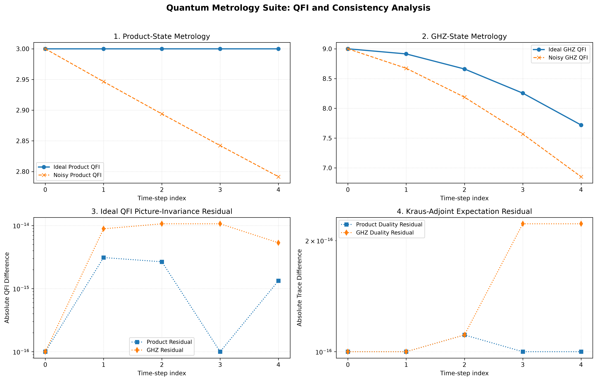

# Quantum Metrology Engine

## Numerical Quantum Fisher Information, Open Quantum Systems, Dual Representations, and Mathematical Foundations

---

## 1. Project Overview

The **Quantum Metrology Engine** is a numerical research project designed to investigate quantum parameter estimation, Quantum Fisher Information (QFI), open quantum systems, and the relationship between Schrödinger and Heisenberg representations.

The project combines mathematical modeling, numerical simulation, and independent consistency checks to explore how quantum states respond to parameter encoding and environmental noise.

It investigates:

- Quantum Fisher Information and parameter-estimation sensitivity.
- Product and GHZ probe-state configurations.
- Unitary quantum evolution.
- Amplitude-damping noise.
- Schrödinger and Heisenberg representations.
- Kraus operators and their adjoint maps.
- Analytical and numerical verification.
- Mathematical relationships between classical and quantum state spaces using Cantor's theorem.
- Possible connections to Processing Element (PE) design, discussed as an open direction in Section 10.

The project is intended as a numerical research framework that can be extended toward more complex quantum systems and sensitivity-aware computational models.

---

## 2. Theoretical Framework

### 2.1 Quantum Fisher Information

Quantum Fisher Information quantifies how sensitive a quantum state is to changes in an unknown parameter.

For a parameter-dependent density matrix $`\rho(\theta)`$, the Symmetric Logarithmic Derivative (SLD), denoted by $`L_\theta`$, is defined through:

```math
\frac{\partial \rho}{\partial \theta} = \frac{1}{2}\left( L_\theta \rho + \rho L_\theta \right)
```

The Quantum Fisher Information is:

```math
F_Q(\theta) = \mathrm{Tr}\left(\rho L_\theta^2\right)
```

It provides an upper bound on the precision obtainable from quantum measurements through the quantum Cramér-Rao bound:

```math
\mathrm{Var}(\hat{\theta}) \geq \frac{1}{\nu F_Q(\theta)}
```

where $`\nu`$ is the number of independent measurements.

A larger QFI corresponds to greater local sensitivity to the parameter being estimated.

### 2.2 Product and GHZ Probe States

The engine compares two different probe-state configurations.

**Product state**

A separable state constructed from individual single-qubit states:

```math
|\psi_P\rangle = |+\rangle^{\otimes N}
```

where:

```math
|+\rangle = \frac{|0\rangle + |1\rangle}{\sqrt{2}}
```

For the collective generator used in the simulation, the initial ideal QFI is:

```math
F_Q^{(P)} = N
```

**GHZ state**

A maximally entangled Greenberger-Horne-Zeilinger state:

```math
|\mathrm{GHZ}\rangle = \frac{|0\rangle^{\otimes N} + |1\rangle^{\otimes N}}{\sqrt{2}}
```

For the same collective generator:

```math
F_Q^{(\mathrm{GHZ})} = N^2
```

These expressions describe the initial ideal states under the selected phase-encoding convention.

---

## 3. Quantum Evolution and Parameter Encoding

The simulation uses a collective generator:

```math
G = \frac{1}{2}\sum_{i=1}^{N} Z_i
```

where $`Z_i`$ is the Pauli-Z operator acting on qubit $`i`$.

The Hamiltonian used for the unitary evolution is:

```math
H = 0.4\sum_{i=1}^{N} X_i
```

The unitary evolution operator is:

```math
U(t) = e^{-iHt}
```

The unknown parameter is encoded through:

```math
U_\theta = e^{-i\theta G}
```

The simulation follows this operation sequence:

1. Initial probe-state preparation.
2. Unitary evolution under the Hamiltonian.
3. Parameter encoding.
4. Independent amplitude-damping noise on each qubit.
5. Numerical QFI evaluation.

The resulting noisy state is:

```math
\rho_\theta(t) = \mathcal{E}\left[ U_\theta U(t)\rho_0 U^\dagger(t) U_\theta^\dagger \right]
```

where $`\mathcal{E}`$ represents the amplitude-damping channel.

---

## 4. Open Quantum Systems and Amplitude Damping

Amplitude damping describes energy relaxation in a quantum system.

For a single qubit, the Kraus operators are:

```math
E_0 = \begin{pmatrix} 1 & 0 \\ 0 & \sqrt{1-p} \end{pmatrix}
```

```math
E_1 = \begin{pmatrix} 0 & \sqrt{p} \\ 0 & 0 \end{pmatrix}
```

The channel acts on a density matrix as:

```math
\mathcal{E}(\rho) = \sum_k E_k \rho E_k^\dagger
```

The Kraus operators satisfy the completeness relation:

```math
\sum_k E_k^\dagger E_k = I
```

For an $`N`$-qubit system, the simulation applies independent amplitude damping to each qubit.

The damping probability is modeled as:

```math
p(t) = 1 - e^{-\gamma t}
```

with:

```math
\gamma = 0.12
```

This allows the engine to examine how environmental relaxation affects parameter-estimation sensitivity over time.

---

## 5. Schrödinger and Heisenberg Representations

An important feature of the project is the comparison between two mathematically equivalent descriptions of ideal quantum evolution.

### 5.1 Schrödinger Representation

In the Schrödinger picture, the quantum state evolves:

```math
\rho(t) = U(t)\rho_0 U^\dagger(t)
```

The parameter derivative for unitary phase encoding is:

```math
\frac{\partial \rho_\theta}{\partial \theta} = -i[G, \rho_\theta]
```

### 5.2 Heisenberg Representation

In the Heisenberg picture, operators evolve instead of states.

The effective generator is:

```math
G_H(t) = U^\dagger(t) G U(t)
```

To express the parameter derivative in the initial-state frame, define:

```math
\widetilde{\rho}_\theta = U^\dagger(t)\rho_\theta U(t)
```

The derivative is then:

```math
\frac{\partial \widetilde{\rho}_\theta}{\partial \theta} = -i[G_H(t), \rho_0]
```

The numerical implementation compares the ideal QFI obtained through both representations.

Their agreement provides an independent consistency check for the unitary evolution and parameter-encoding calculations.

**Important distinction:** This ideal-picture equivalence does not imply that the same simple generator transformation can be applied directly to a noisy channel to calculate noisy QFI.

---

## 6. Kraus Adjoint Map and Duality Verification

The adjoint of a quantum channel is defined as:

```math
\mathcal{E}^*(A) = \sum_k E_k^\dagger A E_k
```

It satisfies the duality identity:

```math
\mathrm{Tr}\left[ A\,\mathcal{E}(\rho) \right] = \mathrm{Tr}\left[ \mathcal{E}^*(A)\,\rho \right]
```

The engine numerically verifies this identity.

This test checks consistency between the channel's Schrödinger action on density matrices and its adjoint action on observables.

The adjoint identity is a mathematical duality relation. It does not imply that noisy QFI can generally be obtained by replacing the generator with $`\mathcal{E}^*(G)`$ in an ideal-state commutator formula.

---


## 7. Numerical Experiment and Results

The simulation compares Product and GHZ probe states in a three-qubit system under unitary evolution, phase encoding, and independent amplitude-damping noise.

### 7.1 Simulation Parameters

| Parameter | Value |
|---|---:|
| Number of qubits | 3 |
| Hamiltonian coefficient | 0.4 |
| Damping rate, gamma | 0.12 |
| Time range | 0.0–0.6 |
| Time step | 0.15 |
| Probe configurations | Product, GHZ |
| Noise model | Independent amplitude damping |
| QFI method | Symmetric Logarithmic Derivative |

### 7.2 Numerical Results

| Probe | Time | Damping Probability | Ideal QFI | Noisy QFI |
|---|---:|---:|---:|---:|
| Product | 0.000 | 0.00000 | 3.000000 | 3.000000 |
| GHZ | 0.000 | 0.00000 | 9.000000 | 9.000000 |
| Product | 0.150 | 0.01784 | 3.000000 | 2.946483 |
| GHZ | 0.150 | 0.01784 | 8.914014 | 8.672599 |
| Product | 0.300 | 0.03536 | 3.000000 | 2.893921 |
| GHZ | 0.300 | 0.03536 | 8.660985 | 8.187613 |
| Product | 0.450 | 0.05257 | 3.000000 | 2.842296 |
| GHZ | 0.450 | 0.05257 | 8.255417 | 7.569258 |
| Product | 0.600 | 0.06947 | 3.000000 | 2.791593 |
| GHZ | 0.600 | 0.06947 | 7.720560 | 6.852148 |

### 7.3 Visualizing the QFI Results

The figure below was generated directly by the simulation code. It contains four panels: ideal and noisy QFI for the Product probe (panel 1) and for the GHZ probe (panel 2), the ideal-picture QFI invariance residual (panel 3), and the Kraus-adjoint expectation residual (panel 4).



*Figure 1. Output of the simulation: `quantum_metrology_dual_adjoint_analysis.png`.*

Notes on reading the figure:

- The horizontal axis is the time-step index, not time itself. Indices 0–4 correspond to t = 0.00, 0.15, 0.30, 0.45, and 0.60.
- In panels 3 and 4 the plotted values are floored at 10<sup>−16</sup> for the logarithmic axis. A point drawn at 10<sup>−16</sup> therefore means a residual of 10<sup>−16</sup> or smaller, including exactly zero.

### 7.4 Analysis of the Results

**1. Product-state ideal QFI remains constant.**

The ideal Product-state QFI stays at 3 across the tested time range. The initial state is |+> tensor-product N, while the Hamiltonian is proportional to the sum of Pauli-X operators. The initial Product state is therefore an eigenstate of this Hamiltonian and acquires only a global phase during the ideal evolution. This explains the constant ideal QFI for the selected configuration.

**2. GHZ ideal QFI decreases during the Hamiltonian evolution.**

The ideal GHZ QFI decreases from 9.000000 at time 0 to 7.720560 at time 0.6, a reduction of approximately 14.2%. Unlike the Product state, the GHZ state is not an eigenstate of the selected Hamiltonian. Its evolution changes the state before parameter encoding and consequently changes its sensitivity to the chosen generator.

**3. Amplitude damping reduces QFI for both probes.**

At time 0.6, the damping probability is approximately 0.06947. The Product-state QFI decreases from its ideal value of 3.000000 to 2.791593, a reduction of approximately 6.95% relative to its ideal value at that time.

For the GHZ probe, the QFI decreases from 7.720560 in the ideal case to 6.852148 with noise, a reduction of approximately 11.25% relative to the ideal GHZ value at the same time.

These comparisons isolate the difference between ideal and noisy QFI at each sampled time. They show that the impact of noise depends on the probe state and the preceding evolution.

**4. GHZ retains higher QFI in this experiment.**

At time 0.6, the noisy GHZ QFI is 6.852148, compared with 2.791593 for the Product probe. The GHZ value is approximately 2.45 times the Product value under the same simulated conditions.

This is a result for this configuration only.

### 7.5 Interpretation and Scope

The numerical results distinguish three effects:

- **Ideal evolution:** changes the GHZ probe's QFI while leaving the Product probe's ideal QFI constant in this configuration.
- **Environmental noise:** reduces QFI for both probe states.
- **Probe-state choice:** the GHZ probe retains higher QFI than the Product probe throughout the sampled time range.

These conclusions apply only to the three-qubit model, Hamiltonian, encoding generator, damping channel, and sampled times used here.


## 8. Analytical Benchmark and Numerical Validation

The engine includes independent checks designed to test its mathematical implementation.

### 8.1 Single-Qubit Analytical Benchmark

For a single-qubit $`|+\rangle`$ probe undergoing phase encoding generated by $`Z/2`$, followed by amplitude damping, the analytical QFI is:

```math
F_Q = 1 - p
```

For:

```math
p = 0.25
```

the expected result is:

```math
F_Q = 0.75
```

The latest numerical output was:

| Measurement | Result |
|---|---:|
| Numerical QFI | 0.75000000 |
| Analytical QFI | 0.75000000 |
| Residual | $`5.551\times10^{-16}`$ |

The analytical benchmark passed.

### 8.2 Ideal Representation Invariance

In the reported run, the maximum numerical residual between the ideal Schrödinger and Heisenberg QFI calculations was:

```math
1.066\times10^{-14}
```

The exact value of such a residual can vary slightly between machines and numerical-library versions; it remains on the order of $`10^{-14}`$. This is consistent with floating-point numerical precision.

### 8.3 Kraus Adjoint Duality

The maximum residual for the Kraus-adjoint expectation identity was:

```math
2.220\times10^{-16}
```

The duality verification passed.

### 8.4 Validation Summary

| Validation | Maximum Residual | Result |
|---|---:|---|
| Single-qubit analytical benchmark | $`5.551\times10^{-16}`$ | PASS |
| Ideal QFI representation invariance | $`1.066\times10^{-14}`$ | PASS |
| Kraus-adjoint duality | $`2.220\times10^{-16}`$ | PASS |

These checks show that the implementation is internally consistent for the cases tested. They are not a proof for other system sizes, states, or noise models.

---

## 9. Mathematical Appendix: Cardinality, State Spaces, and Cantor's Theorem

This section examines a mathematical relationship between infinite classical binary configurations and finite-dimensional quantum pure-state spaces.

The comparison concerns **set cardinality**, not computational power, physical resources, or quantum advantage.

### 9.1 Classical Infinite Binary Configurations

Consider the set of all infinite binary sequences:

```math
S_C = \{0,1\}^{\mathbb{N}}
```

Every binary sequence corresponds uniquely to a subset of the natural numbers: the subset containing precisely those positions at which the sequence has value 1.

Therefore:

```math
\{0,1\}^{\mathbb{N}} \cong \mathcal{P}(\mathbb{N})
```

where $`\mathcal{P}(\mathbb{N})`$ is the power set of the natural numbers.

The cardinality is:

```math
|S_C| = |\mathcal{P}(\mathbb{N})| = 2^{\aleph_0} = \mathfrak{c}
```

Here, $`\mathfrak{c}`$ denotes the cardinality of the continuum.

### 9.2 Finite-N Qubit Pure-State Space

For a system of $`N`$ qubits, the Hilbert space is:

```math
\mathcal{H}_N = \mathbb{C}^{2^N}
```

A pure quantum state is a normalized vector in this space, with vectors differing only by a global phase representing the same physical state.

Consequently, the pure-state space is the complex projective space:

```math
\mathcal{S}_Q = \mathbb{CP}^{2^N-1}
```

For every finite $`N \geq 1`$, this is a finite-dimensional manifold with the cardinality of the continuum.

One way to establish the lower bound is to consider a projective coordinate chart containing a copy of:

```math
\mathbb{C}^{2^N-1} \cong \mathbb{R}^{2(2^N-1)}
```

This set has cardinality $`\mathfrak{c}`$. The full projective space can also be represented using finitely many complex coordinates, so its cardinality cannot exceed $`\mathfrak{c}`$.

Therefore:

```math
|\mathcal{S}_Q| = \mathfrak{c}
```

### 9.3 Equality of Cardinalities

Combining the two results:

```math
|S_C| = |\mathcal{S}_Q|
```

Thus:

```math
\boxed{ |\{0,1\}^{\mathbb{N}}| = |\mathbb{CP}^{2^N-1}| = 2^{\aleph_0} }
```

for every finite $`N \geq 1`$.

This establishes an equality of cardinalities between the set of infinite classical binary sequences and the pure-state space of a finite-$`N`$ quantum system.

### 9.4 Cantor's Theorem

Cantor's theorem states that for any set $`S`$:

```math
|\mathcal{P}(S)| > |S|
```

Applying it to the classical configuration set:

```math
|\mathcal{P}(S_C)| > |S_C|
```

Since:

```math
|S_C| = \mathfrak{c}
```

we obtain:

```math
\boxed{ 2^{\mathfrak{c}} > \mathfrak{c} }
```

This establishes the existence of a strictly larger cardinality in the power-set hierarchy.

However, Cantor's theorem does not establish that the finite-$`N`$ quantum pure-state space has cardinality $`2^{\mathfrak{c}}`$. The quantum state space considered above has cardinality $`\mathfrak{c}`$.

### 9.5 Interpretation and Scope

The equality says only that the two sets have the same number of elements. It does not make classical bit sequences and quantum states equivalent in structure: pure states are vectors of complex amplitudes, they support superposition and entanglement, measurement outcomes follow the Born rule, and parameter sensitivity can be quantified with the QFI.

Cardinality alone says nothing about computational power or information capacity. Its use here is conceptual: it separates the size of a state space from its structure and from the operations that can be performed on it.

---

## 10. Possible Applications (Not Tested Here)

The simulation does not measure anything about hardware. The ideas below are research directions suggested by the QFI and noise analysis. None of them has been tested in this project.

### 10.1 Sensitivity-Aware Precision in Processing Elements

A Processing Element (PE) is the basic compute unit of a processor or accelerator. The idea is to estimate how strongly the final output depends on small errors in each operation, then spend more precision or resources on the sensitive operations and less on the rest. The open question is whether this improves PE efficiency (energy, latency, throughput) at acceptable accuracy.

### 10.2 Other Directions

- **Quantum devices:** probe-state choice, noise characterization, and calibration, using more noise channels and larger systems than studied here.
- **Deep learning:** sensitivity analysis of network parameters and adaptive numerical precision. The link is one of method only; it does not mean that neural networks work through quantum processes.

### 10.3 How It Could Be Tested

The current code does not measure PE performance, power consumption, or hardware utilization. A test would compare a baseline implementation with a sensitivity-aware one on the following metrics:

| Metric | Evaluation Objective |
|---|---|
| Latency | Processing time per operation |
| Throughput | Operations completed per unit of time |
| Energy per Operation | Energy efficiency |
| Computational Accuracy | Numerical error and output precision |
| Hardware Utilization | Processing and memory resource usage |
| Area and Complexity | Hardware cost and implementation overhead |

An improvement should be claimed only if measured gains over a well-defined baseline are shown.

---

## 11. Limitations and Future Work

The current implementation has several limitations.

- The simulation uses a relatively small three-qubit system for its main comparison.
- Only independent amplitude-damping noise is considered.
- The numerical results depend on the selected Hamiltonian, encoding generator, and probe states.
- The ideal Schrödinger-Heisenberg invariance check is not a proof of noisy-picture equivalence.
- The Cantor-theorem result concerns set cardinality only; it says nothing about computational advantage.
- The global Kraus representation generates $`2^N`$ operators for $`N`$ independently damped qubits, and each operator is a $`2^N \times 2^N`$ matrix. This exponential growth in both the number and the size of the operators limits scalability as the system size increases.
- The applications in Section 10, including PE optimization, are untested.

Possible future extensions:

1. Additional noise channels, including dephasing and depolarizing noise.
2. Larger quantum systems.
3. Additional entangled and separable probe states.
4. Alternative parameter-encoding generators.
5. Independent comparison with established quantum-information libraries.
6. More extensive numerical stability and convergence testing.
7. Sensitivity-aware optimization experiments on classical computational workloads.
8. Benchmarking on actual CPU, GPU, FPGA, or other accelerator architectures.
9. More scalable implementations of local quantum channels that avoid explicitly constructing the full global Kraus-operator list.

---

## 12. Requirements and Execution

### Requirements

- Python 3
- NumPy
- SciPy
- Matplotlib
- Jupyter (JupyterLab, Jupyter Notebook, or VS Code with the Jupyter extension)

Install dependencies:

```bash
python -m pip install numpy scipy matplotlib jupyter
```

Run the simulation:

```bash
jupyter notebook quantum-metrology-open-systems.ipynb
```

Then run all cells. The notebook performs the numerical experiments, executes its consistency checks, prints the QFI results, and saves the visualization as `quantum_metrology_dual_adjoint_analysis.png` in the working directory.

---

## 13. Conclusion

The project computes the QFI of three-qubit Product and GHZ probes under unitary evolution and amplitude damping, and checks the implementation in three ways: a single-qubit analytic result, agreement between the Schrödinger and Heisenberg pictures for ideal evolution, and Kraus-adjoint duality. In this configuration the GHZ probe keeps a higher QFI than the Product probe at every sampled time, with and without noise.

The mathematical appendix separates a set-theoretic fact, the equal cardinality of infinite binary sequences and finite-N qubit pure-state spaces, from any claim about computational power.

The engineering ideas in Section 10 are untested. The next step would be to compare a baseline and a sensitivity-aware implementation on measurable metrics.

***

## Additional Documentation

- [CODE_WALKTHROUGH.md](CODE_WALKTHROUGH.md): a step-by-step explanation of the simulation and how the code is organized.
- [WORKED_EXAMPLE.md](WORKED_EXAMPLE.md): a hand-calculated single-qubit example that follows the code line by line.

**Developer/Physicist:** Genady Tabachnik  
**Validation Domain:** Post-Silicon Electro-Optical Integration & Open Quantum Systems Simulation  

## License
This project is licensed under the MIT License.
